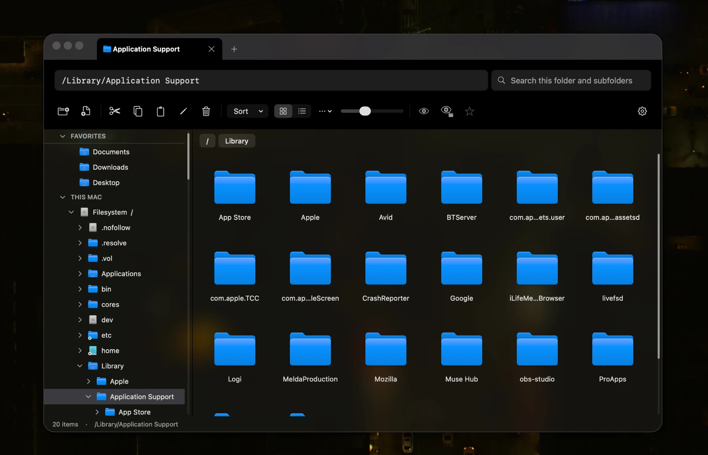

<p align="center">
  
</p>

<h1 align="center">macOS Explorer</h1>

<p align="center">
  A Liquid Glass Finder replacement for macOS.
</p>



Windows File Explorer's editable path bar, full-disk folder tree and cut/paste, combined with Finder's Spotlight search, Trash put-back and native look. Multi-tab and multi-window. Native AppKit, no dependencies. Requires macOS 14; Liquid Glass on macOS 26.

## What Finder doesn't have

- An editable path bar, always visible. Type absolute, relative or `~` paths, with folder suggestions as you type.
- A sidebar folder tree of the whole disk, starting at `/`, with every mounted drive. App bundles expand like folders.
- Hidden files shown for one folder only, or for all folders. `/` shows `/usr`, `/bin` and other hidden system folders out of the box.
- Cut and paste for files.
- New empty files, from the toolbar or the right-click menu.
- Windows-style keys: F2 renames, Return opens.
- Right-drag to move files.
- Search that covers the current folder and its subfolders by default, using the Spotlight index.
- A permissions editor that takes octal (`755`) or chmod-style strings (`u+x,go-w`).
- Liquid Glass window on macOS 26, with opacity, frosting and tint settings, plus custom titlebar tint, accent color and window outline.

## Build

```sh
zsh scripts/build-app.sh
open dist/Explorer.app
```

Each successful build increments the patch version and build number in `Resources/Info.plist`
and creates `dist/Explorer-<version>.zip`. Older ZIPs are kept. Failed compilation or
packaging does not increment the version. To start a new minor or major release,
edit `CFBundleShortVersionString` before building.

In Explorer → Settings → Default File Manager, choose **Use Explorer as Default**
to send “Show in Finder” requests from other apps to Explorer. **Restore Finder**
switches back. Reopen other apps after changing this; a logout may be needed for
cached settings. macOS does not let any app take over opening folders, so folders
double-clicked on the desktop or in the Dock still open in Finder. Apps explicitly
targeting Finder and system Open/Save dialogs are unaffected.

To see protected folders, give Explorer Full Disk Access in System Settings → Privacy & Security.

To regenerate the app icon (needs `rsvg-convert`): `zsh scripts/make-icon.sh`

## Tests

```sh
swift run PathfindChecks
zsh scripts/check-native.sh
```

## Not supported yet

- Connecting to network servers (mounted shares work)
- Finder tags

## Keyboard shortcuts

| Action | Shortcut |
| --- | --- |
| Go to path bar | ⌘L |
| Back / forward | ⌘[ / ⌘] |
| Parent folder | ⌘↑ |
| Refresh | ⌘R |
| Open | Return |
| Rename | F2 |
| New folder | ⌘⇧N |
| Cut / copy / paste | ⌘X / ⌘C / ⌘V |
| Duplicate | ⌘D |
| Move to Trash | ⌘Delete |
| Get Info | ⌘I |
| Show hidden files | ⌘⇧. |
| New tab / close tab | ⌘T / ⌘W |
| Next tab | ⌃Tab |
| New window | ⌘N |
| Settings | ⌘, |
