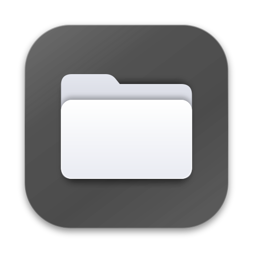
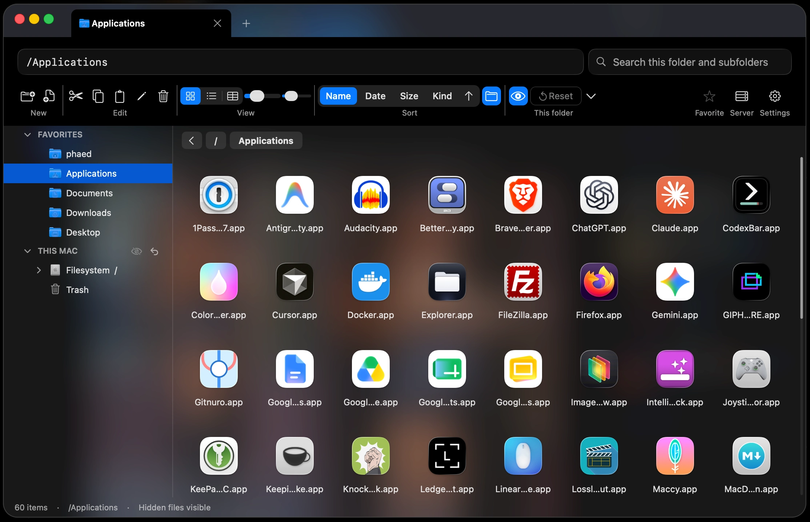
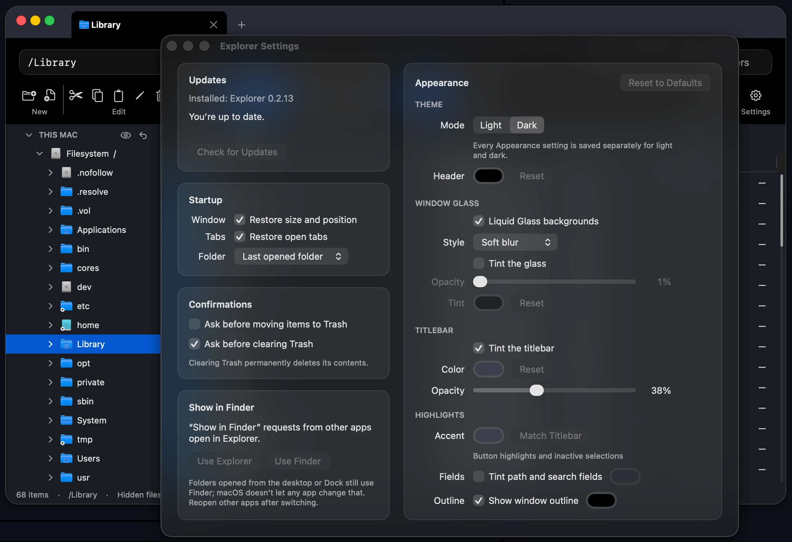

<p align="center">
  
</p>

<h1 align="center">macOS Explorer</h1>

<p align="center">
  A Liquid Glass Finder replacement for macOS.
</p>





Windows File Explorer's editable path bar, full-disk folder tree, combined with Finder's Spotlight search, Trash put-back and native look. Multi-tab and multi-window. Native AppKit with built-in updates. Requires macOS 14; Liquid Glass on macOS 26.

## What Finder doesn't have

- An always-visible, editable path bar with folder suggestions. Takes absolute, relative and `~` paths.
- A sidebar tree of the whole disk from `/`, including hidden system folders and every mounted drive. App bundles open like folders.
- A toolbar with everything one click away: new file or folder, cut, copy, paste, rename, trash, view, sort and hidden files.
- Hidden files per folder, not just on or off everywhere.
- New empty files, from the toolbar or the right-click menu.
- Windows keys: F2 renames, Return opens.
- Right-drag to move files; drop them on a tab to copy them there.
- Open any folder in your terminal app of choice, including iTerm2, Warp, Ghostty, kitty and WezTerm.
- A permissions editor that takes octal (`755`) or chmod strings (`u+x,go-w`).
- Glass styles, tint and opacity, plus custom titlebar, accent and outline colors.

## Install

Download the ZIP from the [latest release](https://github.com/phaed-one/macOS-Explorer/releases/latest),
unzip it, and move **Explorer.app** into **Applications**.

Each release ZIP is scanned with VirusTotal. The badge shows detections across
the engines that completed the latest release scan; click it for the full report.

<!-- VIRUSTOTAL_BADGE_START -->
[](https://www.virustotal.com/gui/file/a85fd6c496bb6c61ac0556e14d6ab29ebdc7275a6a42030e8247be2c6b60b9b5)
<!-- VIRUSTOTAL_BADGE_END -->

## Build from source

You need macOS 14 or later and Xcode 16 or later. Xcode's command-line tools
are enough: `xcode-select --install`.

```sh
git clone https://github.com/phaed-one/macOS-Explorer.git
cd macOS-Explorer
zsh scripts/build-from-source.sh --install
```

The script compiles Explorer, puts it in **Applications** and opens it. It needs
no keys or accounts, and it doesn't change the version or create release files.

- **Build without installing:** run `zsh scripts/build-from-source.sh`. The app
  is saved as `build/Explorer.app`.
- **Update a source build:** run `git pull`, then run the script again.
- **Keep permissions across rebuilds:** run `zsh scripts/setup-signing.sh` once
  before building. It creates a signing identity in your Keychain. Without it,
  each build is signed ad hoc, and macOS asks again for permissions such as
  Full Disk Access.

## Privacy and permissions

Explorer has no analytics or tracking. Your files, searches and browsing
history stay on your Mac. The only time Explorer itself goes online is to check
GitHub for updates. See [Privacy and network activity](docs/privacy.md) for
details.

If protected folders are blocked, Explorer shows a setup window at launch. Enable
Full Disk Access using its Settings button; the window closes when access works.
Restart Explorer if macOS asks.

In Settings → Show in Finder, choose **Use Explorer** to open “Show in Finder”
requests in Explorer. Folders opened from the desktop or Dock still use Finder.

## Keyboard shortcuts

| Action | Shortcut |
| --- | --- |
| Go to path bar | ⌘L |
| Back / forward | ⌘[ / ⌘] |
| Parent folder | ⌘↑ |
| Refresh | ⌘R |
| Open | Return |
| Rename | F2 |
| New folder | ⌘⇧N |
| Undo / redo | ⌘Z / ⇧⌘Z |
| Cut / copy / paste | ⌘X / ⌘C / ⌘V |
| Duplicate | ⌘D |
| Move to Trash | ⌘Delete |
| Get Info | ⌘I |
| Show hidden files in all folders | ⌘⇧. |
| New tab / close tab | ⌘T / ⌘W |
| Next tab | ⌃Tab |
| New window | ⌘N |
| Connect to server | ⌘K |
| Settings | ⌘, |
