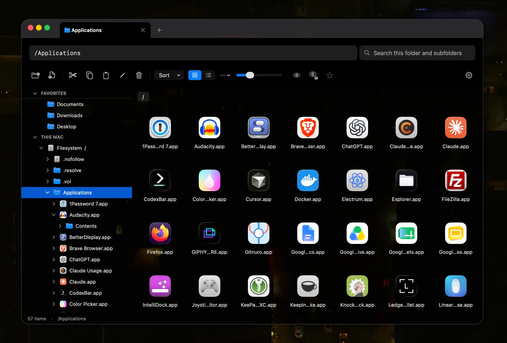

<p align="center">
  
</p>

<h1 align="center">MacOS Explorer</h1>

<p align="center">
  A Liquid Glass, multi-tab Finder replacement for macOS.
</p>



MacOS Explorer is a file manager for people who want more direct control than Finder gives them. It has an editable path bar, a folder tree of the whole disk, tabs and multiple windows, and per-folder settings for views and hidden files. It is a native AppKit app with no third-party dependencies, and it runs with your normal user permissions. Requires macOS 14 or later. Liquid Glass needs macOS 26; earlier versions use the standard blur.

## Features

**Navigation**
- Editable path bar (⌘L). Accepts absolute, relative and `~` paths, with folder suggestions as you type.
- Clickable parent-folder buttons under the toolbar.
- Back ⌘[, forward ⌘], up ⌘↑, refresh ⌘R.

**Sidebar**
- Favorites. Add or remove from a folder's right-click menu or the star button.
- Full folder tree from `/`, plus mounted drives and network shares. App bundles can be expanded.
- Unmount drives, or hide them from the tree.
- Trash, combined across all drives.

**Views**
- Icons view with a size slider, and a Details view with sortable columns.
- Sort by name, date, kind or size, with optional folders-first.
- View settings saved per folder, or set one as the default.
- Hidden files (⌘⇧.) can be toggled globally or for a single folder.

**Search**
- Searches the current folder and its subfolders by name using the Spotlight index. Results update live.

**Files**
- New folder (⌘⇧N), new file, cut/copy/paste, rename (F2), duplicate (⌘D), move to trash (⌘Delete).
- Copy path, Get Info (⌘I) with folder sizes, reveal in Finder.
- Set permissions with checkboxes, octal (`755`) or chmod-style strings (`u+x,go-w`).
- Drag to copy, right-drag to move. Works across folders, tabs and windows.
- Never overwrites existing files.
- Folders refresh when their contents change.

**Trash**
- Restore to the original location.
- Clear Trash, with confirmation.

**Tabs and windows**
- Tabs: new ⌘T, close ⌘W, next ⌃Tab. Each tab has its own history.
- Drag a tab out of the window to open it in a new window, or onto another window to move it.
- New window with ⌘N or from the Dock icon's right-click menu.
- Windows, tabs and tree state are restored on launch.

**Appearance**
- Liquid Glass background on macOS 26, with opacity, frosting and tint settings.
- Adjustable titlebar tint, accent color and window outline.

## Build

```sh
zsh scripts/build-app.sh
open dist/Explorer.app
```

To see protected folders, give Explorer Full Disk Access in System Settings → Privacy & Security.

To regenerate the app icon (needs `rsvg-convert`): `zsh scripts/make-icon.sh`

## Tests

```sh
swift run PathfindChecks
zsh scripts/check-native.sh
```

## Not supported yet

- Connecting to network servers (mounted shares work)
- Finder tags
