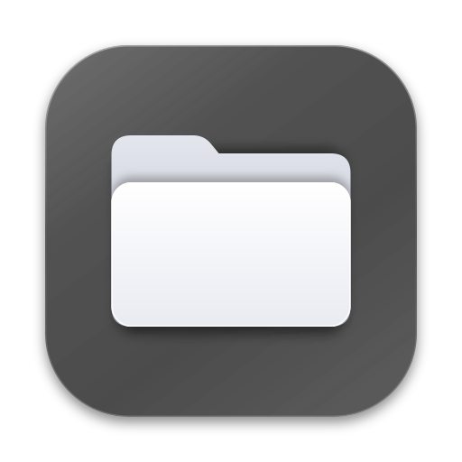
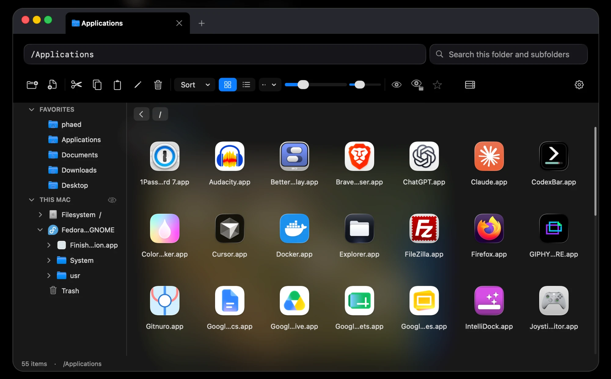
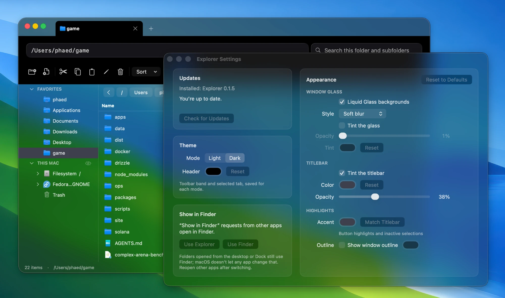

  

<h1 align="center">macOS Explorer</h1>

  A Liquid Glass Finder replacement for macOS.

Windows File Explorer's editable path bar, full-disk folder tree, combined with Finder's Spotlight search, Trash put-back and native look. Multi-tab and multi-window. Native AppKit with built-in updates. Requires macOS 14; Liquid Glass on macOS 26.

## What Finder doesn't have

- An editable path bar, always visible. Type absolute, relative or `~` paths, with folder suggestions as you type.
- A sidebar folder tree of the whole disk, starting at `/`, with every mounted drive. App bundles expand like folders.
- Hidden files shown for one folder only, or for all folders. `/` shows `/usr`, `/bin` and other hidden system folders out of the box.
- New empty files, from the toolbar or the right-click menu.
- Windows-style keys: F2 renames, Return opens.
- Drag tabs out to create new windows.
- Drag files and folders onto other tabs to copy them; right-drag to move them.
- Adjust icon size and spacing with separate toolbar sliders.
- Connect to network servers and browse shared folders.
- Search that covers the current folder and its subfolders by default, using the Spotlight index.
- A permissions editor that takes octal (`755`) or chmod-style strings (`u+x,go-w`).
- Liquid Glass windows and dialogs on macOS 26, in five glass and blur styles, with optional tint and opacity, plus custom titlebar tint, accent color and window outline.

## Install

Download the ZIP from the [latest release](https://github.com/phaed-one/macOS-Explorer/releases/latest),
unzip it, and move **Explorer.app** into **Applications**.

Each release ZIP is scanned with VirusTotal. The badge shows detections across
the engines that completed the latest release scan; click it for the full report.

<!-- VIRUSTOTAL_BADGE_START -->

<!-- VIRUSTOTAL_BADGE_END -->

## Using Explorer

In Settings → Show in Finder, choose **Use Explorer** to open “Show in Finder”
requests in Explorer. Folders opened from the desktop or Dock still use Finder.

If protected folders are blocked, Explorer shows a setup window at launch. Enable
Full Disk Access using its Settings button; the window closes when access works.
Restart Explorer if macOS asks.

Click the server icon to the right of Favorites on the toolbar (⌘K) and enter an address, such as
`smb://server/share`. Sign in if asked, then browse the share in Explorer.
SMB, AFP, NFS, and WebDAV servers are supported.

Right-click a folder or empty space to open a terminal in that folder. Explorer
finds your installed terminals and offers a choice when you have several.

Supported terminals: **Terminal, iTerm2, Warp, Warp Preview, Ghostty, kitty,
Alacritty, WezTerm, Hyper, Tabby, Rio, Contour, Cool Retro Term, and cmux**.

An orange dot on Settings means an update is available. Open Settings and click
**Update** to install it and restart Explorer.

## Not supported yet

- Finder tags

## Keyboard shortcuts

| Action | Shortcut |
| --- | --- |
| Go to path bar | ⌘L |
| Back / forward | ⌘[ / ⌘] |
| Parent folder | ⌘↑ |
| Refresh | ⌘R |
| Open | Return |
| Rename | F2 |
| New folder | ⌘⇧N |
| Cut / copy / paste | ⌘X / ⌘C / ⌘V |
| Duplicate | ⌘D |
| Move to Trash | ⌘Delete |
| Get Info | ⌘I |
| Show hidden files | ⌘⇧. |
| New tab / close tab | ⌘T / ⌘W |
| Next tab | ⌃Tab |
| New window | ⌘N |
| Connect to server | ⌘K |
| Settings | ⌘, |

## Development

See the [development guide](docs/development.md) for building, testing, signing,
and publishing releases.
